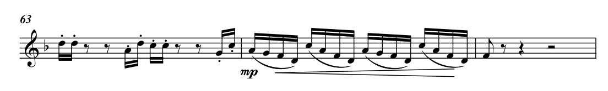
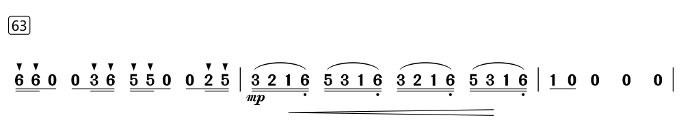
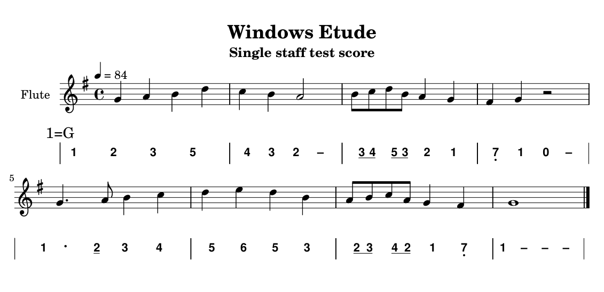
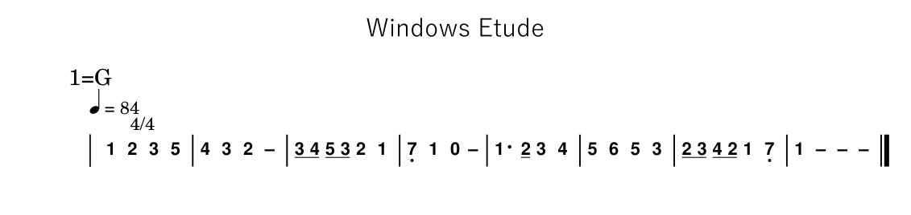

# Windows 五线谱转简谱

把单声部乐器五线谱 PDF 转成**线简对照稿**和可打印的**纯简谱**。在原版的基础上增加了可以使用agent接入串联JPWord进行自主编辑精修的功能，面向像我一样的局部转调困难户和强迫症患者。面向单乐器分谱。Windows x64 支持 CPU 和 NVIDIA CUDA 识谱，可用 Agent 辅助逐小节校对，也可用 JPword 做演奏版精修。

[实际效果](#实际效果) · [Windows 安装](#windows-安装) · [转一首新谱](#转一首新谱) · [GPU 推理](#gpu-推理) · [Agent 接入](#agent-接入) · [来源与贡献](#来源与贡献)

## 实际效果

### 《秦兵马俑》曲笛演奏版

彭修文曲《秦兵马俑》，第 63 小节起的局部。上图为原五线谱，下图为已经在 JPword 复校并导出的曲笛简谱。可以对照看到跳音点写作实心倒三角 ▼，并保留了连奏、力度和渐强渐弱。此处展示局部谱例，谱例仅用于说明转谱效果。





### 可复跑的长笛样谱

同一份原创样谱的实际输出。原位对照把简谱放到对应的五线谱下方，保留原谱 4＋4 小节的分行。独立纯简谱按纸面重分行，样谱的 8 小节排在一行。

| 原位线简对照 | 纯简谱 |
| --- | --- |
|  |  |

[五线谱原件](examples/validated/staff.pdf) · [完整 PDF 与测试记录](examples/validated/README.md)

## Windows 安装

使用 64 位 Windows、PowerShell、Git 和 [uv](https://docs.astral.sh/uv/getting-started/installation/)。首次安装和下载识谱模型需要联网。安装脚本准备 Python 3.11、Homr、固定版本的 music_translator 和 LilyPond。

```powershell
git clone https://github.com/dingle2001/windows-jianpu.git
Set-Location windows-jianpu
powershell.exe -NoProfile -ExecutionPolicy Bypass -File .\setup-windows.ps1 -Backend cpu
```

乐谱和任务目录可用中文。LilyPond 与识谱中间文件使用 ASCII 路径。如果系统临时目录含中文，给安装脚本传入 `-ScratchRoot`，指定只包含英文、数字等 ASCII 字符且可写的临时目录。

用公开样谱试跑一次。每次使用新的任务目录。

```powershell
.\examples\smoke-windows.ps1 -Job './jobs/sample'
```

[GitHub Windows 测试](https://github.com/dingle2001/windows-jianpu/actions/workflows/windows.yml)会在全新环境安装 CPU 依赖，并从原始样谱 PDF 跑到可复验的纯简谱和线简对照稿。

## 转一首新谱

```text
原始五线谱 PDF → Homr 识谱 → MusicXML 逐小节校订
                               ├─ 线简对照 PDF
                               ├─ 纯简谱 PDF
                               └─ 可选 JPword 工程 → 桌面精修与导出
```

```powershell
$env:PYTHONUTF8 = '1'
$py = (Get-Content ./runtime.local.json -Raw | ConvertFrom-Json).python
$job = './jobs/my-score'
$score = Read-Host '输入原始五线谱 PDF 的路径'
& $py ./workflow.py prepare $score --job $job
```

1. 打开 `source.pdf`、`review/` 和 `omr.raw.musicxml`，按页码、行、小节核对音高、时值、调拍、连线、休止和装饰音。写出 `reviewed.musicxml` 和 `review-notes.md`。已有初稿可在 `prepare` 时加 `--draft`；校对仍以源 PDF 为准。
2. 运行 `handoff` 和 `render`。默认用首调，可用 `--pitch-mode fixed --fixed-tonic C` 选择固定调名。先确认移调乐器的书面音或实音口径。
3. 打开 `edition-01/alignment.insitu.pdf` 和 `edition-01/numbered.jianpu.pdf`，检查分行、符号和裁切，保存实际检查结果到任务目录中的 `print-review.md`，再执行 `finalize`。

```powershell
& $py ./workflow.py handoff --job $job
& $py ./workflow.py render --job $job --title '曲目名称'
& $py ./workflow.py finalize --job $job --review (Join-Path $job 'print-review.md')
```

定稿路径为 `edition-01/delivery/performance.pdf`。修订后重新交接，并在排版、定稿时分别指定同一个新版本，例如 `--edition edition-02`。`handoff --fold-multirests` 可在对照稿中折叠多小节休止，校订母稿保留原小节结构。

### JPword 精修

希望纯简谱严格按原谱逐行分小节时，准备一份已完成的 JPword 原生模板。在 `render` 加 `--template` 和 `--instrument`，会得到可编辑的 `editable.jpwabc` 和工程检查报告。模板分支使用首调。可用 `--row-gap-mm` 调整谱行间距，用 `--page-start` 指定新页的行首小节。用 JPword 打开工程并导出，测量长休止符位置并逐页检查跳音 ▼、原生 tr、倚音、力度、跨行连线和页边距，再以 `finalize --pdf` 归档导出的印刷版。

## GPU 推理

有受支持的 NVIDIA GPU 时，使用兼容 CUDA 12 的 NVIDIA 驱动。CUDA 环境独立安装，包含 ONNX Runtime GPU 和 CUDA/cuDNN 运行库。首次下载体积较大。已用 RTX 4070 Laptop GPU 从原谱样例跑通识谱和输出。

```powershell
nvidia-smi
powershell.exe -NoProfile -ExecutionPolicy Bypass -File .\setup-windows.ps1 -Backend cuda
.\examples\smoke-windows.ps1 -Job './jobs/sample-cuda'
(Get-Content './jobs/sample-cuda/omr-runtime.json' -Raw | ConvertFrom-Json).observed_homr_providers
```

在 `observed_homr_providers` 中看到 `CUDAExecutionProvider`，表示有实际执行的 Homr 模型会话使用 CUDA 为首选执行提供程序。个别算子仍可能在 CPU 执行，排版继续由 LilyPond 处理。样谱脚本会核查分割、编码器和解码器三个 Homr 会话的提供程序。若只看到 CPU，检查任务日志、驱动和 CUDA DLL。在同一项目里切回 CPU 时重新运行 `-Backend cpu` 安装指令，后续命令使用 `runtime.local.json` 记录的后端。

## Agent 接入

具备本地文件读取、图片查看和命令执行能力的 Agent 可直接走 CLI。支持 stdio MCP 的客户端还可以连接本地 JPword 服务，查询 MusicXML、核对源谱、生成 JPword 工程、调整文字及行距，并按导出 PDF 校准长休止符。[Agent 校对指令](docs/agent-review.md) · [MCP 配置与工具](docs/jpword-mcp.md) · [更新记录](CHANGELOG.md)

### Kimi Code 贯通入口

`kimi_pipeline.py` 用一份任务参数贯通全流程，阶段进度写入任务目录，人工核对或 JPword 窗口不可用后直接重跑同一命令即可续跑：

```powershell
$template = 'D:\谱面\模板.jpwabc'   # PowerShell 中勿直接写尖括号
& $py ./kimi_pipeline.py --config ./runtime.local.json run --pdf $score --job $job --title '曲目名称' --template $template
& $py ./kimi_pipeline.py status --job $job   # 查看阶段进度
```

阶段依次为 prepare（识谱）→ review（人工核对，等待退出码 2）→ handoff → render → jpword-export（等待 JPword 桌面导出，退出码 3）→ audit → finalize。JPword 导出阶段约定：单实例运行，用 Kimi CU 虚拟鼠标打开「导出打印」菜单，逐帧读取两次确认并点击「是」，同名保存矢量 PDF 后复制为 `<job>/<edition>/jpword-export.pdf`；Codex CU 与 Kimi CU 串行占用输入，不并行驱动桌面。

逐页目检记录写在 `<job>/<edition>/print-review.md`，首行必须绑定当前导出的完整哈希：`PDF SHA-256: <64 位十六进制>`（审计阶段会给出这一行）。导出换版或哈希不一致时定稿拒绝（退出码 2），防止旧目检被复用。PowerShell 中尖括号会被当作保留运算符，模板路径请先存入变量：`$template = 'D:\谱面\模板.jpwabc'` 再 `--template $template`。

把 JPword 工具注册进 Kimi Code：

```powershell
powershell.exe -NoProfile -ExecutionPolicy Bypass -File .\mcp\install-kimi-mcp.ps1 -Root '<乐谱工作目录>'
```

脚本合并写入 `~/.kimi-code/mcp.json`（不覆盖已有服务），新开会话即可调用 `jpword_*` 工具。校准常数：参考模板下长休止符横向 2.400 mm/工程单位、普通文字纵向约 3.0 mm/工程单位，其他模板用 `offset_scale` 传入实测比例。

## 来源与贡献

1. xuxiran 的早期五线谱转简谱工作，为本项目提供方法参考。[xuxiran/translate-staff-to-simple-musical-notation](https://github.com/xuxiran/translate-staff-to-simple-musical-notation)
2. starpacker 的原项目提供五线谱识别、原位线简对照与独立简谱排版，是 Windows 版的直接运行依赖。[starpacker/music_translator](https://github.com/starpacker/music_translator)
3. Apple Silicon macOS 适配版，支持 Core ML 和 Agent 校谱。Windows 工作流接续了该版本的线简对照及交接经验。[dingle2001/music-translator-macos](https://github.com/dingle2001/music-translator-macos)

欢迎大家在原项目的基础上继续完善、优化并开源成果。使用、引用、移植或改进时，请在文档或发布说明中标明出处、保留上游和贡献者署名，并遵循相应许可证。[AGPL-3.0](LICENSE) · [第三方声明与谱例版权](THIRD_PARTY_NOTICES.md)
